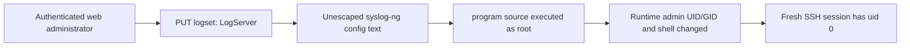

# EX3301-T0: from stock Y1 access to a root SSH shell

This repository documents one owner-authorized Zyxel EX3301-T0 investigation. The device started on Hyperoptic `V5.50(ABVY.4.1)Y1`, was upgraded to official Zyxel `V5.50(ABVY.7.2)C0`, and was then used to verify an **authenticated LogServer-to-syslog-ng configuration injection**. A temporary root process was observed. A separate change to the runtime `admin` account made a fresh SSH session run as `uid=0`. Zyxel's advisory identifies the `LogServer` issue as **CVE-2026-6952** and lists a broader affected-product range.

The vulnerability is in log configuration generation, **not in the SSH protocol or Dropbear authentication**. The full root SSH result was verified for the current boot only. No reboot-persistent root access was demonstrated.

The repository contains sanitized notes and a local-only string demo. It contains no passwords, session tokens, certificate or host-key fingerprints, serial number, MAC address, personal network address, configuration backup, or firmware image. Later third-party firmware work is outside this case study.

## Tested scope

| Item | Evidence-backed value |
| --- | --- |
| Hardware | One Zyxel EX3301-T0 |
| Starting firmware | Hyperoptic `V5.50(ABVY.4.1)Y1` |
| Firmware used for root verification | Official `V5.50(ABVY.7.2)C0` |
| Starting web role | `medium` administrator |
| SSH baseline | `admin` reached restricted `ZySH>` on Y1 and C0; a direct `root` login with the existing administrator credential failed on C0 |
| Proven root behavior | `id` printed `uid=0(root) gid=0(root)`; after a runtime account change, a new SSH session independently returned `id -u = 0` |

Our live root proof covers only the device and C0 image above. Zyxel's separate affected-product list is summarized below. Neither source establishes an unauthenticated path or WAN access in this case.

## Zyxel's official affected-product list

Zyxel's [21 July 2026 advisory for CVE-2026-6952](https://www.zyxel.com/global/en/support/security-advisories/zyxel-security-advisory-for-post-authentication-command-injection-vulnerability-in-certain-dsl-ethernet-cpe-fiber-onts-and-wireless-extenders-07-21-2026) describes an administrator-authenticated command injection in the syslog `LogServer` field. It lists **EX3301-T0 `5.50(ABVY.8)C0` and earlier** as affected and **`5.50(ABVY.8.1)C0`** as the available patch. Thus the `7.2C0` build tested here falls within Zyxel's published affected range. The advisory lists **42 affected models**: 29 DSL/Ethernet CPE models, 10 fiber ONTs, and 3 wireless extenders. The [complete official list](docs/official-advisory.md) includes every model, affected version, and listed patch.

Zyxel explicitly excludes ISP-customized models from that table. The earlier Hyperoptic Y1 build in this device's history was **not** separately tested for the LogServer vulnerability. The vendor's patch listing is not a local validation that `8.1C0` is safe to install on an ISP-customized unit; Zyxel directs ISP customers to their provider for the appropriate firmware. The advisory confirms the `LogServer` entry point and OS-command effect; the syslog-ng configuration path and `uid=0` result below come from this project's own analysis and test.

## The observed sequence

1. **Find the router on a direct Ethernet link.** The originally guessed management address was wrong. The computer's network details identified the actual default gateway, which led to the Y1 web interface.
2. **Reveal the firmware upgrade page.** The authenticated `medium` administrator's `login_privilege` `Page` list was updated to include `Firmware_Upgrade`; a fresh `MenuList` response showed the page. This changed web navigation, not Linux identity or firmware acceptance.
3. **Keep SSH on the LAN.** The SSH management service was set to `LAN_ONLY`, read back, and used for the restricted `ZySH>` login.
4. **Turn off two Y1 runtime image checks.** The exact `zycli` commands and observed readback are below. After this, one retry of the official 7.2C0 image booted successfully. The sequence does not establish which check caused the earlier upload failure, and the two switches are separate from RSA signature verification.
5. **Prove root execution on C0.** Before the test, `admin` still entered restricted `ZySH>` and a direct `root` login with the existing credential failed. The authenticated `logset` API then accepted a `LogServer` value that broke out of a syslog-ng destination string and introduced a `program()` source and `log` route. An independent SSH PTY showed `uid=0(root) gid=0(root)`. The original logging object was restored through two ordered writes and full readback.
6. **Verify root SSH separately.** The temporary root channel changed only the runtime `admin` UID/GID and login shell. A fresh password-based SSH login and a separate `id -u` command both proved root identity. The password field and other accounts were unchanged. This was **not** verified across a reboot.

### Exact Y1 `fwidcheck` and `modelcheck` commands

After logging into the router's **LAN-only SSH** as `admin`, the prompt was `ZySH>`. Use your own router address in place of `<ROUTER_LAN_IP>`:

```text
ssh admin@<ROUTER_LAN_IP>
ZySH> zycli modelcheck show
The modelcheck is enable now. ret:0
ZySH> zycli fwidcheck show
The fwidcheck is enable now. ret:0
ZySH> zycli modelcheck off
ZySH> zycli fwidcheck off
ZySH> zycli modelcheck show
The modelcheck is disable now. ret:-17
ZySH> zycli fwidcheck show
The fwidcheck is disable now. ret:-17
```

The `off` response itself was not retained; the final `show` lines are the observed Y1 readback before uploading C0. The extracted **C0** command table labels these switches runtime checks and states `#Not support save to flash#`; this static help is not a Y1 reboot test. Their state after the C0 reboot was **not** established: later `show` calls returned to the prompt without status text. See [Firmware check commands](docs/firmware-checks.md) for the exact evidence and limits. Do not treat these commands as a generic unsigned-image or RSA-signature bypass.

## Mechanism at a glance



The original `Enable=false` setting did not prevent the proof because the injected text supplied its own `source` and `log` statements. A normal destination-only route would depend on the firmware's category logging gate. See [Technical analysis](docs/technical-analysis.md) for the static call chain and the separate live observations.

## Read the case study

- [Chronology](docs/chronology.md) — initial access through the root SSH verification.
- [Official advisory scope](docs/official-advisory.md) — Zyxel's CVE-2026-6952 model list, affected versions, and patch versions.
- [Firmware check commands](docs/firmware-checks.md) — how the two Y1 checks were turned off and what the readback proves.
- [Technical analysis](docs/technical-analysis.md) — authenticated input, config generation, root process, and runtime account promotion.
- [Evidence and limits](docs/evidence.md) — sanitized evidence ledger with hashes of private originals.
- [Reproduction and restoration](docs/reproduction.md) — staged verification and the two-write log restoration order.
- [Mitigations](docs/mitigation.md) — firmware and administrator actions.
- [Security policy](SECURITY.md) — how to report additional affected versions privately.

## Run the offline demonstration

Node.js 20 or newer is sufficient; there are no package dependencies:

```sh
npm test
npm run demo
```

The test and demo only expand the observed syslog-ng format string in local memory. They do not log in, open a network connection, write router settings, or prove another firmware is vulnerable.
