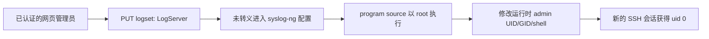

# Zyxel EX3301-T0：从 Y1 后台到 root SSH 的实证记录

这是一台本人管理的 EX3301-T0 的研究记录。它整理了从 Hyperoptic Y1 后台访问、官方 C0 固件迁移，到在 `V5.50(ABVY.7.2)C0` 上取得 root 进程和完整 root SSH 会话的证据。本文所说的漏洞是**认证后的日志配置注入**，并非 SSH 服务自身的认证绕过。

项目只包含脱敏的研究材料和离线演示；不含密码、Cookie、证书指纹、设备序列号、固件镜像、配置备份或个人网络地址。后续第三方固件安装不在范围内。

## 已验证结果

| 阶段 | 结果 |
| --- | --- |
| Hyperoptic Y1 | 网页管理员为 `medium`；将 `Firmware_Upgrade` 加入其可见页面后，上传入口出现。此步骤不改变 Linux UID。 |
| 官方 C0 | 在已关闭 `fwidcheck`、`modelcheck` 的实机上，官方 `V5.50(ABVY.7.2)C0` 启动，网页和 SSH 登录成功。 |
| 普通 SSH | `admin` 登录是受限 `ZySH>`；原有凭据直接登录 `root` 失败。 |
| 命令执行 | 经认证的 `LogServer` 值被写入 syslog-ng 配置；临时证明命令返回 `uid=0(root) gid=0(root)`，随后日志配置恢复。 |
| root SSH | 临时 root 通道修改本次启动的 `admin` UID、GID 与 shell；新 SSH 会话及独立 `id -u` 均返回 0。 |

**持久性边界：** root SSH 只在当前启动得到验证。原厂会重建运行时账户文件，未证明重启后仍保留该权限。后续 root 密码修改也仅验证了当前运行时；本文不把它称为永久方案。

## 技术路径



- [时间线](docs/chronology.md)：各阶段发生了什么。
- [技术分析](docs/technical-analysis.md)：入口、配置生成链和 root 执行机制。
- [证据与局限](docs/evidence.md)：观察值、静态分析、未验证事项。
- [复现与恢复](docs/reproduction.md)：在授权设备上如何逐项核对和恢复。
- [修复建议](docs/mitigation.md)：对厂商和设备管理员的建议。
- [离线演示](tools/offline-demo.mjs)：只在本机展示配置字符串如何被打断，不连接设备。

## 离线演示

需要 Node.js 20 或更新版本，不需要依赖包：

```sh
npm test
npm run demo
```

演示只验证字符串拼接与长度边界；它不证明其他固件版本受影响，也不会登录或修改路由器。

## 适用范围

实机验证范围为官方 `V5.50(ABVY.7.2)C0`、EX3301-T0、已认证的网页管理员会话和同一局域网中的 SSH。没有对其他型号、运营商版本或当前最新固件作漏洞结论。固件迁移过程是这台设备的历史记录，不是通用刷机建议。

如发现新的影响范围或修复版本，请先通过 [SECURITY.md](SECURITY.md) 中的方式联系维护者，再决定公开细节。
