# Technical analysis: from authenticated log configuration to root SSH

## Scope and observed result

This case concerns one Zyxel EX3301-T0 running the official `V5.50(ABVY.7.2)C0` firmware. The findings combine static analysis of that firmware with an authorized test on the device. They do not establish that another firmware version, device revision, or management role is affected. The analyzed firmware sample has SHA-256 `1958230af33f46879f592f90fbd5cea0e16a51d5c352fa3c9560cb832df472bc`.

An authenticated administrator was able to make a logging component execute with Linux `uid=0`. The temporary execution channel was then used to change only the running `admin` account's UID, GID, and login shell. A **new** SSH session reached a full root shell, and a separate `id -u` check returned `0`. That SSH result was verified only during the current boot.

The entry point is **configuration syntax injection through `LogServer` into a generated syslog-ng file**. This is an authenticated privilege escalation. SSH served as the later login and verification path; the evidence does not identify a flaw in the SSH daemon, SSH protocol, or SSH authentication. No unauthenticated path was tested.

## Trust boundary and execution path

```mermaid
flowchart LR
    A[Authenticated management session] -->|PUT logset| B[DAL and RDM log settings]
    B -->|LogServer inserted into text| C[Generated syslog-ng configuration]
    C -->|Configuration loaded| D[syslog-ng program source]
    D -->|Observed UID 0 process| E[Temporary root execution]
    E -->|Runtime account change| F[admin UID/GID 0 and /bin/sh]
    F --> G[New SSH session with UID 0]
```

1. The web interface submits logging settings through `PUT /cgi-bin/DAL?oid=logset`. Its `LogServer` input has a 127-character limit and is disabled in `Local` mode. Those client-side controls are not a server-side security boundary.
2. In the analyzed DAL function, `Remote` and `LocalRemote` modes copy `LogServer` into the RDM log object. The decoded field path has no field-specific IP-address syntax check. This does **not** prove that every generic DAL or RDM validation check is absent.
3. With a usable remote server value and TLS disabled, `beLogSetup` inserts `LogServer` as an unescaped `%s` inside a syslog-ng `udp("%s" ...)` destination. A colon in the server value selects the UDP6 format instead. The back end writes a temporary configuration, replaces the active one, and restarts logging. The analyzed flaw is in the **generated configuration language**, not direct interpolation into the shell command that starts syslog-ng. The TLS branch was observed in the binary but was not analyzed as a separate live exploit path.
4. The shipped syslog-ng includes the `program()` source driver. Its implementation invokes `/bin/sh -c` for the program string. The generated configuration can therefore cross from logging data into process execution if additional valid syslog-ng statements are accepted and loaded.

### Why `Enable=false` did not block the observed path

The original `logset` had `Enable=false`. In the analyzed back end, the remote destination is emitted **before** the `Enable` check. That check skips the normal per-category `log` routes when logging is disabled. A destination left unreferenced by those normal routes would not, by itself, reliably demonstrate command execution.

The tested injection instead broke out of the destination's quoted value and supplied its **own top-level `source` and `log` statements**. That route can connect a `program()` source to the emitted destination without relying on the category routes skipped by `Enable=false`. The static configuration grammar supports those statement types, and the authorized device test observed the resulting root UID. The offline demo shows the string-expansion boundary only; on its own it cannot prove acceptance, service startup, or execution on a device.

This distinction matters for fixes: disabling ordinary logging routes does not make an unescaped value safe if the configuration parser can still read injected top-level statements.

## Static evidence from the 7.2C0 sample

The addresses below refer to the extracted MIPS ELF files from the named firmware sample. They are not portable offsets for other builds.

| Component | Relevant observation | Representative location |
| --- | --- | --- |
| `/lib/libzcfg_fe_dal.so` | `zcfgFeDalLogSettingcfg` reads `LogMode` and `LogServer`, merges remote-mode values, and skips a `LogServer` update in effective `Local` mode | `0xDE614`; reads at `0xDE698–0xDE6F8`; mode-dependent update at `0xDEA50–0xDEC38` |
| `/lib/private/libzcfg_be.so` | `beLogSetup` emits the remote destination using the unescaped server value | `0xF8B48`; UDP write at `0xF94EC–0xF9538` |
| `/lib/private/libzcfg_be.so` | The destination is written before the `Enable` category-route gate; the back end replaces the configuration and restarts syslog-ng | gate at `0xF97B8`; replacement/restart at `0xFA3F8–0xFA4E8` |
| `/usr/lib/syslog-ng/libafprog.so` | The `program()` driver launches its program through `/bin/sh -c` | `0x2A98–0x2ABC` |

The firmware analysis explains the mechanism and the order of configuration generation. It cannot, without the device observation, prove that a candidate value passes all validation, parses as intended, or runs with a particular UID.

## Authorized device observations

| Stage | Observation | Supported conclusion |
| --- | --- | --- |
| Baseline SSH | `admin` entered the restricted `ZySH>` interface; the same credentials did not log in directly as `root` | The initial administrator login did not provide a Linux root shell |
| Logging test | A separate administrator SSH PTY displayed `uid=0(root) gid=0(root)` | The logging configuration path produced a UID 0 process on this device; this was not yet an interactive root SSH login |
| Runtime account change | `admin` UID/GID changed from `21` to `0`, and the shell changed from `/usr/bin/zysh` to `/bin/sh`; its password field and other accounts were left unchanged | The temporary root channel promoted the running account rather than changing SSH authentication |
| Independent SSH check | A new SSH session succeeded and `id -u` returned `0` | Full root SSH was verified for the current boot |
| Cleanup | The original logging fields were read back after restoration; this privilege-escalation test did not write a firmware partition or switch a boot slot | The temporary logging configuration was removed, without claiming a complete device security audit |

`/etc/passwd` points to the runtime `/tmp/var/passwd`. The stock account-generation process may overwrite this change on restart or when accounts are regenerated. **Root SSH for `admin` was not verified across a reboot.** A later runtime root-password change and new SSH login were also observed, but that password change was not synchronized with the stock account data and has no verified reboot persistence. Neither runtime change should be described as permanent access.

## Configuration restoration nuance

When the effective mode is `Local`, the analyzed DAL skips a submitted `LogServer` update. Submitting `Local` and the original server value in a single request therefore cannot reliably clear a temporarily stored remote value. In the recorded restoration, the server field was reset and read back while the mode was still `Remote` or `LocalRemote`; only then was `Local` restored and the complete original `logset` compared. Each submission can regenerate the file and restart logging, so a successful API response alone is not proof that cleanup completed.

The repository contains a sanitized [evidence summary](evidence.md) and an [offline string demo](../tools/offline-demo.mjs). It contains no device credentials, configuration backup, firmware binary, personal network address, SSH host fingerprint, or live device-writing client. The scope does not include unrelated services or account-persistence schemes.
